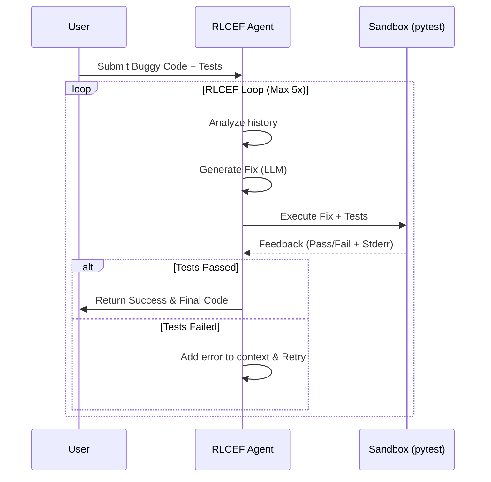
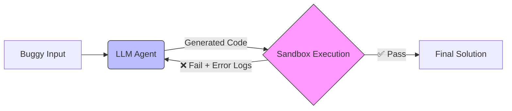

# RLCEF Code Agent: Self-Fixing Code via Execution Feedback

An autonomous agent that fixes buggy Python code by iteratively running it, analyzing execution errors, and self-correcting—inspired by **[Poolside AI](https://poolside.ai)**'s RLCEF (Reinforcement Learning from Code Execution Feedback) approach.

**Author:** Mayank Mahawar ([LinkedIn](https://www.linkedin.com/in/mayank-mahawar-46032a4b/))  
**Status:** Working Prototype (v0.1)

---

## 🚀 Overview

Most coding assistants are "one-shot" generators: they guess code and hope it works. If it fails, you have to verify and fix it manually.

**This agent is different.** It mimics a human developer's debugging loop:
1.  **Generates** a potential fix using an LLM.
2.  **Executes** the code + tests in an isolated sandbox.
3.  **Analyzes** real stdout/stderr and traceback logs.
4.  **Iterates** on its own mistakes until tests pass.

It uses **Groq's Llama 3.3 70B** for inference and a custom **pytest** sandbox for execution.

---

## ⚡️ Demo: Factorial Bug Fix

**The Input:** A function with an infinite recursion bug (missing base case).

```python
# Buggy code
def factorial(n):
    return n * factorial(n - 1)  # ❌ Missing base case

# Tests
assert factorial(5) == 120
assert factorial(0) == 1
```

**The Agent's Process:**



**The Result (after 1 iteration):**

```python
def factorial(n):
    if n == 0 or n == 1:
        return 1
    else:
        return n * factorial(n - 1)
```

---

## 🏗 Architecture

The system consists of three main components working in a feedback loop.



| Component | Technology | Role |
|-----------|------------|------|
| **Brain** | Llama 3.3 70B (via Groq) | Analyzes code and error logs to generate fixes. |
| **Sandbox** | standard python `subprocess` | Executes code in a controlled environment to capture `stdout`/`stderr`. |
| **Loop** | Python Orchestrator | Manages the conversation history (RLCEF trace) and feedback injection. |

---

## 🛠 Installation

### Prerequisites
- Python 3.9+
- [Groq API Key](https://console.groq.com/) (free beta access available)

### Setup

```bash
# 1. Clone the repository
git clone https://github.com/mayankiitkgp/poolside-rlcef-agent.git
cd poolside-rlcef-agent

# 2. Create and activate virtual environment
python3 -m venv venv
source venv/bin/activate  # Windows: venv\Scripts\activate

# 3. Install dependencies
pip install -r requirements.txt

# 4. Configure Environment
cp .env.example .env
# Open .env and add your key: GROQ_API_KEY=your_key_here
```

---

## 💻 Usage

### Quick Start (Factorial Demo)
Run the included demo to see the agent fix a predefined buggy function:

```bash
python -m src.agent.rlcef_loop
```

### Use in Your Own Code
Import the agent as a library to fix your own functions:

```python
from src.agent.rlcef_loop import fix_code_with_rlcef

buggy_code = """
def add_numbers(a, b):
    return a * b  # Any bug here
"""

test_code = """
def test_add():
    assert add_numbers(2, 3) == 5
"""

# Run the RLCEF loop
result = fix_code_with_rlcef(
    buggy_code=buggy_code, 
    test_code=test_code, 
    max_iterations=5
)

if result['success']:
    print(f"✅ Fixed in {result['iterations']} iterations")
    print(result['final_code'])
else:
    print("❌ Failed to fix code")
```

---

## 🔮 Roadmap

- [x] **Core RLCEF Loop**: Basic feedback loop with execution.
- [x] **Sandbox Integration**: Capture `stdout` and `stderr` reliably.
- [ ] **Multi-File Support**: Allow fixing bugs that span multiple files.
- [ ] **RAG Integration**: Retrieve relevant documentation/context for complex bugs.
- [ ] **Docker Isolation**: Move sandbox from `subprocess` to Docker containers for security.
- [ ] **Visual UI**: Streamlit interface for interactive debugging.

---

## 🧠 Inspiration & References

This project explores the **inference-time** application of RLCEF. While [Poolside AI](https://poolside.ai) trains massive models using this feedback signal (RL training), this agent demonstrates that **runtime** execution feedback can significantly improve the performance of off-the-shelf LLMs without fine-tuning.

*   [Poolside AI](https://poolside.ai)
*   [Groq Inference Engine](https://groq.com)
*   [Paper: Grounding Code LLMs in Execution Feedback](https://arxiv.org/abs/2402.05929) (Example reference)

---

## 🤝 Contributing

Contributions are welcome! Please feel free to verify the sandbox security or add support for new languages.

1.  Fork the Project
2.  Create your Feature Branch (`git checkout -b feature/AmazingFeature`)
3.  Commit your Changes (`git commit -m 'Add some AmazingFeature'`)
4.  Push to the Branch (`git push origin feature/AmazingFeature`)
5.  Open a Pull Request

---

**License:** MIT  
**Contact:** [Mayank Mahawar](https://www.linkedin.com/in/mayank-mahawar-46032a4b/)