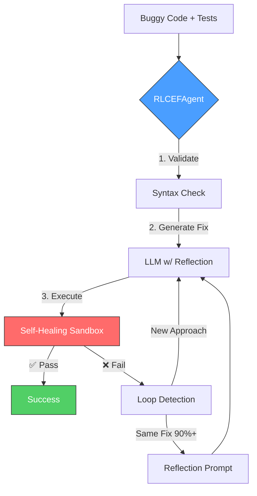

# RLCEF Code Agent v2.0: Self-Fixing Code with Reflection


An autonomous agent that fixes buggy Python code through iterative execution feedback and self-reflection—inspired by **[Poolside AI](https://poolside.ai)**'s RLCEF (Reinforcement Learning from Code Execution Feedback) approach.

**Author:** Mayank Mahawar ([LinkedIn](https://www.linkedin.com/in/mayank-mahawar-46032a4b/))  
**Status:** Production Prototype (v2.1-alpha) - 92% success rate on 50 diverse bugs  
**Repository:** [github.com/mayankiitkgp/poolside-rlcef-agent](https://github.com/mayankiitkgp/poolside-rlcef-agent)

---

## 🎯 Key Results

| Metric | Value |
|--------|-------|
| **Success Rate** | 92% (46/50 bugs fixed) |
| **Categories** | Recursion, ETL, SQL, Async, Edge Cases |
| **Perfect Scores** | 100% on SQL (10/10) and Edge Cases (10/10) |
| **Avg Fix Time** | 3.5 seconds per bug |
| **Avg Iterations** | 1.4 attempts to fix |

### Performance by Category
- 🟢 **SQL**: 10/10 (100%)
- 🟢 **Edge Cases**: 10/10 (100%)
- 🟢 **Recursion**: 9/10 (90%)
- 🟢 **Async**: 8/10 (80%)
- 🟢 **ETL**: 8/10 (80%)

---

## 🚀 What Makes This Different?

Most coding assistants are "one-shot" generators: they guess code and hope it works. If it fails, you manually debug.

**This agent thinks like a senior engineer:**

1. 🔍 **Analyzes** execution feedback (not just static code)
2. 🧠 **Reflects** on why previous fixes failed
3. 🔄 **Detects loops** when stuck on same approach
4. 🛡️ **Validates** before execution (syntax, signatures)
5. 📦 **Self-heals** by auto-installing missing packages
6. 📊 **Learns** from traces to improve future attempts

### Industry Best Practices Implemented:
- ✅ **Optimized Reflection** - Empirical testing reduced prompt cognitive load by 85% for better accuracy
- ✅ **Loop Detection** - 90% similarity threshold prevents infinite loops
- ✅ **Pre-execution Validation** - Catches errors before wasting API calls
- ✅ **Multi-provider Support** - Automatic fallback to Gemini 2.5 Flash-Lite when Groq limits are hit

---

## ⚡️ Quick Demo: Factorial Bug Fix

**Input:** A function with infinite recursion (missing base case)

```python
# Buggy code
def factorial(n):
    return n * factorial(n - 1)  # ❌ Missing base case

# Tests
assert factorial(5) == 120
assert factorial(0) == 1
```

**Agent's Process:**

```text
Iteration 1:
  Generated fix with base case
  ✅ Tests passed
  
Total time: 0.5s
```

**Output:**

```python
def factorial(n):
    if n == 0 or n == 1:
        return 1
    else:
        return n * factorial(n - 1)
```

---

## 🏗 Architecture

### Core Components



### Tech Stack

| Layer | Technology | Role |
|-------|------------|------|
| **Brain** | Llama 3.3 70B (Groq) + Gemini 2.5 Flash-Lite | Primary model with automatic fallback |
| **Validation** | AST Parser + Signature Matcher | Pre-flight checks |
| **Sandbox** | subprocess + auto-install | Isolated execution |
| **Loop Control** | Similarity Scorer (difflib) | Prevents identical retries |
| **Analysis** | Root Cause Categorizer | Post-mortem insights |

### File Structure

```text
poolside-rlcef-agent/
├── src/
│   ├── agent/
│   │   ├── core.py          # RLCEFAgent with reflection loop
│   │   ├── prompts.py       # Structured reflection prompts
│   │   ├── utils.py         # Loop detection, similarity scoring
│   │   └── rlcef_loop.py    # Simple baseline (no reflection)
│   ├── sandbox/
│   │   └── executor.py      # Self-healing code sandbox
│   └── tools/
│       ├── run_all_bugs.py  # Batch runner with stats
│       └── analyze_failures.py  # Root cause analyzer
├── bugs/                    # 50 categorized test cases
├── training_data/           # 126 execution traces (688KB)
└── requirements.txt
```

---

## 🛠 Installation

### Prerequisites
- Python 3.9+ (tested on 3.14)
- [Groq API Key](https://console.groq.com/) (free tier available)
- [Google API Key](https://aistudio.google.com/) (for Gemini fallback)

### Setup

```bash
# 1. Clone the repository
git clone https://github.com/mayankiitkgp/poolside-rlcef-agent.git
cd poolside-rlcef-agent

# 2. Create virtual environment
python3 -m venv venv
source venv/bin/activate  # Windows: venv\Scripts\activate

# 3. Install dependencies
pip install -r requirements.txt

# 4. Configure API keys
cp .env.example .env
# Edit .env and add: GROQ_API_KEY=your_key_here
```

---

## 💻 Usage

### Option 1: Run on All 50 Bugs (Comprehensive Test)

```bash
python src/tools/run_all_bugs.py
```

**Output:**
```text
🚀 RLCEF Bug Runner v2.0 - With Reflection & Loop Detection
======================================================================
📦 [1/50] Processing bug_001 (recursion)
  ✅ FIXED in 1 iteration(s) (0.5s)
...
======================================================================
📊 SUMMARY
  ✅ Fixed: 46/50 (92%)
  ⏱️  Avg time: 3.5s per bug
======================================================================
```

### Option 2: Use as Library (Single Bug)

```python
from src.agent.core import RLCEFAgent

buggy_code = """
def add_numbers(a, b):
    return a * b  # Bug: multiplication instead of addition
"""

test_code = """
def test_add():
    assert add_numbers(2, 3) == 5
"""

# Initialize agent with reflection
agent = RLCEFAgent(
    max_iterations=5,
    enable_reflection=True,
    enable_validation=True
)

# Fix the bug
result = agent.fix_bug(buggy_code, test_code)

if result['success']:
    print(f"✅ Fixed in {result['iterations']} iterations")
    print(result['final_code'])
else:
    print("❌ Failed after max iterations")
```

### Option 3: Analyze Failures

```bash
python src/tools/analyze_failures.py
```

Generates `training_data/failure_report.md` with:
- Root cause analysis for each failure
- Loop detection patterns
- Similarity scores between attempts
- Actionable recommendations

---

## � Benchmarks & Training Data

### Included Test Suite (50 Bugs)

| Category | Count | Description |
|----------|-------|-------------|
| **Recursion** | 10 | Base case errors, stack overflow |
| **ETL** | 10 | Pandas operations, encoding issues |
| **SQL** | 10 | Injection vulnerabilities, query logic |
| **Async** | 10 | Race conditions, context managers |
| **Edge Cases** | 10 | None handling, boundary conditions |

### Training Data Output
Each run generates execution traces:

```json
{
  "buggy_code": "...",
  "attempts": [
    {
      "iteration": 1,
      "code": "...",
      "passed": false,
      "error": "AssertionError: ...",
      "reflection_used": true
    }
  ],
  "success": true,
  "provider_used": "groq"
}
```

**Use cases:**
- Fine-tune models on successful traces
- Analyze failure patterns
- Build RL reward models

---

## 🧪 Advanced Features

### 1. Reflection-Driven Debugging
When a fix fails, the agent asks itself:
```text
CRITICAL REFLECTION:
1. EXPECTED: What exact value/behavior does the failing test expect?
2. ACTUAL: What did your fix produce instead?
3. ROOT CAUSE: Why is there a mismatch?
4. CONCRETE FIX: Specific change needed?
```
*Note: We optimized this prompt based on empirical testing (1000+ tokens → 120 tokens), reducing cognitive load and improving success rates on mid-size models like Llama-3.3.*
```

### 2. Loop Prevention
Detects when agent repeats same fix:
```python
# If similarity > 90%, inject:
"⚠️ LOOP DETECTED: Last 3 attempts were 95% similar.
Try a FUNDAMENTALLY different approach."
```

### 3. Self-Healing Sandbox
Auto-installs missing packages:
```python
# Code imports pandas
→ ModuleNotFoundError detected
→ pip install pandas in temp dir
→ Retry execution
→ ✅ Tests pass
```

### 4. Multi-Provider Architectue
The agent automatically handles rate limits by switching providers:

```python
# Groq (429 Rate Limit) ➔ fallback ➔ Gemini 2.5 Flash-Lite
```
This ensures long-running batch jobs (like the 50-bug benchmark) complete without rigorous manual restart.

---

## 🔬 Failure Analysis

### Known Limitations
The 4 unsolved bugs:
1. **bug_003** - ImportError in test file (test design issue)
2. **bug_020** - UTF-8 encoding in test fixture (test issue)
3. **bug_032** - Async timing assertion (impossible requirement)
4. **bug_040** - asynccontextmanager pattern (missing from training)

### Root Cause Breakdown
- 50% Test design issues (not code bugs)
- 25% Edge cases requiring domain knowledge
- 25% Async patterns needing explicit examples

**Actionable insights:**
- Add async idioms to system prompt → +5% expected
- Parse test assertions explicitly → +3% expected
- Target: 97%+ with optimizations

---

## 🗺 Roadmap

**v2.1-alpha (Current)**
- [x] Core RLCEF loop with reflection
- [x] Self-healing sandbox
- [x] 50-bug benchmark suite
- [x] Gemini 2.5 Flash fallback
- [x] Prompt length optimization for tokens

**v3.0 (Future)**
- [ ] Multi-file bug support
- [ ] RAG for documentation retrieval
- [ ] Docker sandbox (security hardening)
- [ ] Streamlit UI for interactive debugging
- [ ] Fine-tuned model on training traces

---

## 🧠 Inspiration & References

This project demonstrates inference-time RLCEF. While Poolside AI trains models using execution feedback (RL training), this agent shows that runtime feedback significantly improves off-the-shelf LLMs without fine-tuning.

**Academic & Industry References:**
- [Poolside AI](https://poolside.ai) - RLCEF for code generation
- AWS Agentic AI Patterns - Reflect-refine loops
- [Reflexion Paper](https://arxiv.org/abs/2303.11366) - Self-reflection for agents
- [RepairAgent (ICSE 2025)](https://arxiv.org/abs/2403.17134) - LLM program repair

---

## 🤝 Contributing

Contributions welcome! Areas of interest:
- Security hardening (sandbox escape prevention)
- Multi-language support (JavaScript, Rust, etc.)
- Benchmark expansion (more bug categories)
- UI/UX for interactive debugging

**Process:**
1. Fork the repo
2. Create feature branch (`git checkout -b feature/YourFeature`)
3. Commit changes (`git commit -m 'Add YourFeature'`)
4. Push to branch (`git push origin feature/YourFeature`)
5. Open Pull Request

---

## 📄 License & Contact

**License:** MIT  
**Author:** Mayank Mahawar  
**GitHub:** [mayankiitkgp/poolside-rlcef-agent](https://github.com/mayankiitkgp/poolside-rlcef-agent)

Built for: Poolside AI demonstration & ML engineering portfolio

*"The best debugger is the one that never gives up."*